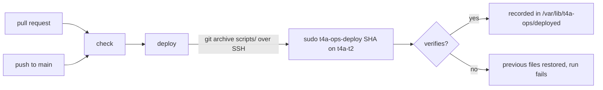

# Runbook: t4a-ops CI/CD

How this repo's files reach **t4a-t2**, how to set the server up for it once,
and what to do when a deploy fails. Decision record: [ADR-0002](../adr/0002-t4a-ops-ci-cd.md).

## What is deployed

`.github/workflows/ci.yml` (workflow `ci`) runs `check` → `deploy`.

Only `scripts/` is deployed. `docker/` holds reference compose files (secrets
redacted) and is checked, never deployed; the server copies stay hand-edited.

| Repo file | Installed as | Mode |
|-----------|--------------|------|
| `scripts/backup.sh` | `/usr/local/bin/t4a-backup.sh` | 0750 |
| `scripts/systemd/t4a-backup*.{service,timer}` | `/etc/systemd/system/` | 0644 |
| `scripts/deploy/t4a-ops-deploy.sh` | `/usr/local/sbin/t4a-ops-deploy` | 0755 |

`/etc/t4a-backup.env` is **never** touched; new keys in `scripts/backup.env.example`
are merged by hand (see [Backup & Restore](./backup-restore.md)). The deploy
never enables or disables a timer either.



**check** runs on every pull request and every push to `main`:

- gitleaks over the working tree (the repo is public)
- `bash -n` and shellcheck on every `scripts/**/*.sh`
- `systemd-analyze verify` on the units
- `docker compose config` on every reference compose file (structure only)
- actionlint on the workflows
- lychee on relative links and anchors in every Markdown file

**deploy** runs only on `main` after a green check, one at a time (concurrency
group `deploy-prod`, shared by name with the app repos). It pins the server's
host key to `PROD_DEPLOY_FINGERPRINT`, streams `git archive HEAD scripts` over SSH
as `deploy`, and runs `sudo -n /usr/local/sbin/t4a-ops-deploy <sha>`, which:

1. refuses an archive with a missing file or a `.sh` that does not parse,
   before changing anything;
2. copies every installed file aside, then installs the new ones by
   rename, so a backup that is running keeps its old copy of the script;
3. `systemctl daemon-reload`, and restarts only the timers that were active and
   whose unit file changed (a changed schedule needs it);
4. verifies: `bash -n` the installed script, `systemd-analyze verify` the units,
   timers that were active are still active, and `t4a-backup.sh check`
   (config is valid, `restic`/`mariadb-dump`/`mongodump`/`docker` and the
   restic password file exist) once `/etc/t4a-backup.env` exists;
5. on failure, restores the previous files, reloads and fails the run;
   on success, writes the SHA to `/var/lib/t4a-ops/deployed`.

It deploys on every push to `main`, docs-only ones too: it costs seconds and
puts back anything edited by hand on the server.

## GitHub settings

Organization secrets (same values as t4a-admin; share them with this repo):

| Secret | Value |
|--------|-------|
| `PROD_DEPLOY_HOST` | The VM's hostname or IP |
| `PROD_DEPLOY_SSH_KEY` | Private key whose public half is in `deploy`'s `authorized_keys` |
| `PROD_DEPLOY_FINGERPRINT` | `SHA256:…` of any of the host's keys, e.g. `ssh-keygen -lf /etc/ssh/ssh_host_ecdsa_key.pub` |

Create a `production` environment in the repo settings and limit it to the
`main` branch. Optional repository variable: `DEPLOY_USER` (default `deploy`).

## Server setup (once)

The deploy user may run only the installer as root. As root on t4a-t2, from a
checkout of this branch (or after merge, of `main`):

```bash
install -m 0755 -o root -g root scripts/deploy/t4a-ops-deploy.sh /usr/local/sbin/t4a-ops-deploy

cat > /etc/sudoers.d/t4a-ops-deploy <<'SUDO'
deploy ALL=(root) NOPASSWD: /usr/local/sbin/t4a-ops-deploy
SUDO
chmod 0440 /etc/sudoers.d/t4a-ops-deploy
visudo -cf /etc/sudoers.d/t4a-ops-deploy

# Dry run of what CI does, from the same checkout:
git archive --format=tar.gz HEAD scripts | /usr/local/sbin/t4a-ops-deploy "$(git rev-parse HEAD)"
```

From then on the installer updates itself with every deploy.

> The rule gives `deploy` root over these files. `deploy` already runs Docker,
> which is root-equivalent, so this widens nothing; the installer only
> writes the paths in its `MANIFEST`.

## Symptoms

- The `deploy` job of the `ci` workflow is red.

## Diagnosis

1. Read the job log. The installer prints `deploying <sha> (changed: …)` and
   then either `deployed <sha>` or the failed check followed by
   `verification failed, restoring the previous files`.
2. Current state on the server:

   ```bash
   sudo t4a-ops-deploy --status        # last deployed SHA + timers
   ```

| Failure | Cause |
|---------|-------|
| `no host key of the server matches PROD_DEPLOY_FINGERPRINT` | Host key changed or secret wrong. Check `ssh-keygen -lf /etc/ssh/ssh_host_*_key.pub` on the VM |
| `deploy secret for … is empty` | Org secrets not shared with this repo |
| `sudo: a password is required` | Sudoers rule missing; see [Server setup](#server-setup-once) |
| `config error: …` / `check: … is not installed` | `/etc/t4a-backup.env` incomplete or a backup tool missing. The nightly backup would fail the same way |
| `systemd-analyze verify` output | Bad unit file; also fails `check` on the pull request |

## Resolution

1. Fix the cause and re-run the failed job, or push the fix through a pull request.
2. The previous files were restored, so the server is in its last good state.
   To deploy an older commit on purpose, re-run that commit's `ci` workflow.

## Monitoring

- `sudo t4a-ops-deploy --status` shows the SHA it matches.
- `systemctl list-timers 't4a-backup*'`: next runs are still scheduled.

## Escalation

- Grega (repo owner).
